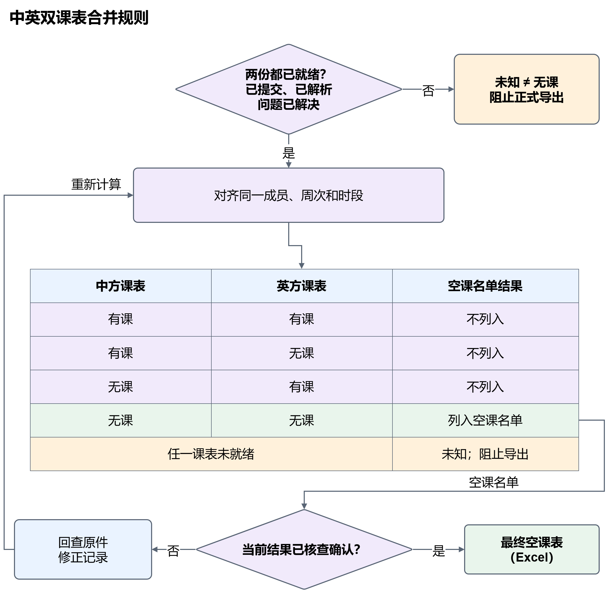
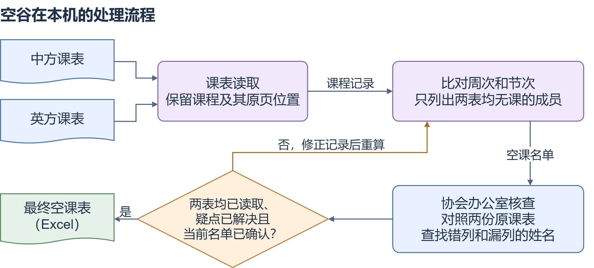

# 空谷 Konggu

<p align="center">
  
</p>

<p align="center">
  面向中英合办学生组织的离线空课生成工具。
  <br />
  批量读取中方、英方课表 PDF，合并课程占用，核对后导出集体空课表。
</p>

<p align="center">
  
  
  
  
</p>


<p align="center">
  <a href="#开始使用">开始使用</a> ·
  <a href="#工作流程">工作流程</a> ·
  <a href="#如何判断空课">合并规则</a> ·
  <a href="#常见问题">常见问题</a> ·
  <a href="#开发">开发</a>
</p>

空谷是青禾计划孵化的课表协作产品，面向需要汇总多人中方、英方课表的学生组织。它读取成员提交的 PDF，合并两边的课程，再按周次和节次列出没有课的成员，核对后导出 Excel。

课表读取和图片文字识别都在 Windows 本机完成，原件不会上传到外部识别服务。

## 工作流程

[](docs/images/readme/konggu-workflow.png)

以协会办公室为例，工作人员导入课表、处理问题，对照原件核查名单后导出。

## 为什么做空谷

项目来自学院青协办公室制作成员空课表的经历。工作人员要逐个打开中方、英方课表，把每一节没课的人名抄进 Excel。复查时，既发现过有课的人被列入名单，也发现过没课的人被漏掉；检查一个名字，又要回到两份原课表里找。

空谷接手读取、比对和汇总，工作人员仍负责核查有疑问的记录。导出后，负责人可以按任务时段找人，再联系成员确认安排。这里的“空课”只表示没有课程，不表示成员已经答应参加。

- 一次导入多人的课表，检查成员身份及中方、英方配对是否完整。
- 按周次和节次合并课程，查看每个时段的空闲人数和名单。
- 从存疑的记录回到 PDF 原页，修正后重新计算。
- 核对后导出 Excel，保留来源、问题和修正记录。

## 开始使用

### 准备课表

每位成员需要提供同一学期的中方、英方两份 PDF。文件名要包含成员姓名，以及“中方”或“英方”，例如下面的命名格式（将“成员姓名”换成实际姓名）：

```text
成员姓名-中方课表.pdf
成员姓名-英方课表.pdf
办公室-成员姓名-中方课表.pdf
办公室-成员姓名-英方课表.pdf
```

只有“课表.pdf”或“schedule.pdf”这样的文件名，无法确定成员和课表类型，需要先改名。不同目录中的同名 PDF 也需要区分。如果文件名与课表正文里的姓名不一致，应先确认归属。

缺少一方课表、文件损坏或课表被截断时，请补齐或更换原件。这些问题解决前，不能把未识别到的课程当作空闲时间。

### 导入和生成

1. 打开空谷，等待左侧“本地识别”显示已就绪。
2. 在“课表资料”中导入成员的 PDF，检查文件名及中方、英方分类。
3. 展开“学期设置”，按校历填写第一周开始日期（周一）和教学周数，保存设置。
4. 点击“生成空课表”。有文字层的 PDF 会优先直接读取，需要识别图片时使用本地 OCR。
5. 在“核对问题”中处理异常，可从问题直接打开对应原文；到“空课结果”按周查看空闲时段，点击格子查看完整人员。
6. 检查通过后，在“空课结果”右上角点击“导出空课表”，保存为 `.xlsx` 文件。

[安装与使用说明](docs/安装与使用_0.6.0_v1.0.txt) · [0.6.9 候选与验收记录](docs/交付验收_0.6.9_v1.0.md)

上面的操作步骤对应本地在研的 0.7.0 界面，设计与专项验证见[界面记录](docs/design/ui-0.7.0/README.md)。本版安装候选正在构建，最近已记录完整验收的候选仍为 0.6.9，其界面入口与新版不同；基础安装步骤沿用 0.6.0 说明。选择安装包前，请查看[版本与已知限制](#版本与已知限制)。

## 结果与核对

0.7.0 将操作与内容整理为三个工作区；各区内保留原有核对和查看能力：

| 工作区 | 用途 |
| --- | --- |
| 课表资料 | 导入与生成，查看文件检查、成员课表和课程占用周视图 |
| 核对问题 | 处理待核对事项，定位对应 PDF，填写修正原因并重算 |
| 空课结果 | 切换周表和明细，展开完整人员名单，通过检查后导出 |

0.6.9 安装版仍显示“共同空闲、成员课表、文件检查、待处理、原文核对、课程周视图”六个标签；其安装与验证范围见对应交付记录。

## 如何判断空课

同一成员、同一教学周、同一节次，只要中方或英方任意一边有课，就不列入空课名单。两份课表都成功读取、相关问题已解决，并且该节都没有课，才列入名单。缺交或读不清的部分保留为待解决问题。

<details>
<summary>查看双课表合并规则图</summary>

[](docs/images/readme/konggu-merge.png)

</details>

识别完成后，结果有三种状态：

| 状态 | 含义与处理方式 |
| --- | --- |
| `accepted` | 质量检查已通过；来源、学期和解析签名仍有效且实时导出检查通过时可以导出 |
| `needs_review` | 有图片识别、课程时间等内容需要核对，处理完才能正式导出 |
| `blocked` | 有缺失、身份冲突、解析失败或学期范围错误，需要先补文件、改设置或修正结果 |

点击确认只记录核对结果，不能绕过阻断错误。人工修正会记录原值、新值、原因和操作者；源文件或解析规则变化后，旧修正需要重新检查。

导出的 Excel 包含空课表以及成员、来源、问题和修正记录，便于排班时回查。软件通过检查也可能有漏识别；正式安排前，仍应核对重要时段，并向成员确认课表之外的安排。

## 常见问题

<details>
<summary>本地识别服务启动失败</summary>

识别程序启动时需要解压文件，临时目录至少要有 1 GiB 可用空间。默认位置空间不足或不可写时，空谷会尝试其他本地固定磁盘。请按窗口提示处理空间或权限问题，再点击“重新启动识别服务”。

如果提示识别材料缺失或校验失败，可以在“本地维护”中点击“修复识别功能”，从安装包内置资源恢复。提示安装组件异常时，需要使用完整安装包重新安装。

</details>

<details>
<summary>课程周次超出了学期范围</summary>

先检查第一周开始日期和教学周数。春季起始日配上秋季课表，就可能把课程算到第几十周。待处理事项会显示当前日历范围和越界日期，也可以点击“前往学期设置”修改。请按原课表和校历填写，保存后重新生成。

</details>

<details>
<summary>课程时间识别错了</summary>

在“原文核对”中打开对应 PDF，核对后修改课程时间并填写原因。当前还没有专门用于恢复或删除“教研”等告示区域占用的操作入口；遇到这类误判，应保留待复核状态，修复解析问题后再生成。

</details>

<details>
<summary>能否导入图片或其他学校的课表</summary>

当前入口接收 PDF，PDF 内的图片页可以走本地 OCR。识别规则主要依据现有中方、英方课表编写，新版式仍可能识别不完整，需要对照原件检查。

</details>

## 版本与已知限制

截至 **2026-11-15 本次文档同步**，GitHub 已提交的应用代码与版本清单仍为 **0.6.5**；本页所述 **0.7.0** 是本地在研工作区，相关应用代码与版本清单另行提交。0.7.0 的界面和识别已完成分项验证，安装候选正在构建，尚无完整交付验收结论。

最近已记录完整验收的安装候选为 **0.6.9**，完成了该版本真实原件回归、本机安装循环与安装目录接口流程验收，尚未公开发布。使用前请查看[0.6.9 交付记录](docs/交付验收_0.6.9_v1.0.md)中的源材料要求和未完成验收项。

英方午间课程通过完整时间轴与课程格边界校验映射到 12:40–13:25、13:30–14:15；无法可靠映射时提示复核。详情浮层只有在原 PDF 底层完整空格得到核实时才消除误报；图片遮挡、未配对日期和文字不完整继续保留相应门禁。验证数量与范围见交付记录，不作为未见课表或整学期准确率。

可生成空课的周次受原件实际日期范围限制；查询结束后额外显示的空白行不会当作无课。跨机、多账户权限、物理断网及其他历史版本数据迁移尚未验收，当前安装与桌面流程的逐项结果见[0.6.9 交付记录](docs/交付验收_0.6.9_v1.0.md)。

课表识别的独立人工真值只覆盖指定周的工作日时段，整学期和未见版式尚未完成同等范围的核验。既有秋季批次的 28 份必需 OCR 输入已完成空缓存重识别，不能据此推定后续在研改动或其他材料同样通过。使用时仍需对照原件核查；测试通过数量和解析一致性结果不能作为识别准确率。详细范围见[0.6.9 交付记录](docs/交付验收_0.6.9_v1.0.md)和[待办](MEMORY/待办.md)。

## 开发

桌面端使用 Tauri 2 和 TypeScript，Python 3.12 负责课表处理。PDF 文字层由 PyMuPDF 读取，图片识别使用本地 PaddleOCR / PP-OCRv4 mobile 模型，Excel 由 openpyxl 生成。依赖版本以 `package-lock.json`、`requirements.txt` 和 `src-tauri/Cargo.lock` 为准。

<details>
<summary>查看本机处理流程图</summary>

[](docs/images/readme/konggu-architecture.png)

这张图说明数据和核查步骤。界面、工作流服务与解析代码的具体位置见下方目录表。

</details>

### 本地运行

开发环境需要 Node.js、Python 3.12，以及可编译 Tauri Windows 项目的 Rust/MSVC 工具链。以下命令在项目根目录的 PowerShell 中执行；安装依赖和首次下载 OCR 模型需要联网。

```powershell
python -m venv .venv
.\.venv\Scripts\python.exe -m pip install -r requirements.txt
npm.cmd ci
npm.cmd run prepare:offline
```

只查看前端时，运行 `npm.cmd run dev:frontend`。普通浏览器无法调用本地识别功能。

桌面调试还需要与源码匹配的 `src-tauri/binaries/konggu-worker-x86_64-pc-windows-msvc.exe`。完整的 `npm.cmd run build` 流程会打包并准备该程序，之后可用 `npm.cmd run dev` 启动桌面调试。`npm.cmd run build:sidecar` 只在独立候选目录生成识别程序，不会自动替换桌面端使用的文件。

### 检查与构建

```powershell
# Python 测试
.\.venv\Scripts\python.exe -m pytest -q

# TypeScript 检查与前端构建
npx.cmd tsc --noEmit
npm.cmd run build:frontend

# 桌面层检查
cargo check --manifest-path src-tauri\Cargo.toml --locked

# 提交前隐私检查
.\.venv\Scripts\python.exe tools\check_repo_privacy.py

# Windows 离线安装候选
npm.cmd run build
```

安装包构建还需要本地 NSIS 和 WebView2 离线安装器等资源，准备及检查逻辑见[构建脚本](scripts/build-candidate.ps1)。受信任证书签名使用 `npm.cmd run build:release:signed`，配置见[签名脚本](scripts/build-release-signed.ps1)。

测试分层和真实样本回归方法见[测试说明](tests/README.md)。真实课表放在版本库外，提交测试数据时使用脱敏材料。

### 代码目录

| 目录 | 内容 |
| --- | --- |
| `src/` | 桌面界面、PDF 核对和课程周视图 |
| `src-tauri/` | Windows 窗口、进程启动和安装配置 |
| `app/` | Python 命令接口与工作流服务 |
| `core/` | 课表解析、占用合并、质量检查和导出相关逻辑 |
| `config/` | 日历配置与版式、节次、OCR 元数据；实际消费范围见配置说明 |
| `resources/` | 离线资源清单与 OCR 模型；参考资料在 `reference/` 子目录 |
| `tests/` | 业务规则、工作流和回归测试 |

### 离线资源

安装包包含 OCR 模型和配置。启动时，空谷会校验资源并复制到可写目录，默认不允许运行时下载模型。

```text
%LOCALAPPDATA%\Konggu\resources
%LOCALAPPDATA%\Konggu\ocr_models
%LOCALAPPDATA%\Konggu\cache
%LOCALAPPDATA%\Konggu\logs
```

Windows 用户目录含中文、Paddle 无法读取模型时，会改用 `%PROGRAMDATA%\Konggu\ocr_models`。开发者显式设置的 ASCII 路径 `KONGGU_OCR_MODEL_DIR` 优先使用。

## 其他文档

- [项目说明](docs/项目说明.md)与[质量门禁](docs/状态与质量门禁.md)：业务范围、结果状态及导出条件。
- [变更记录](docs/变更记录.md)与[项目志](docs/PROJECT_CHRONICLE.md)：各版本修改和历史验证记录。
- [项目总览](MEMORY/MEMORY.md)与[待办](MEMORY/待办.md)：当前进度和未完成事项。
- [协作规则](AGENTS.md)与[参考资料](resources/reference/README.md)：开发约定、样例和历史材料。
- [界面设计规范](docs/界面设计规范.md)：界面布局、交互和视觉约定。
- [配置与持久化边界](docs/配置与持久化边界.md)：配置是否真正影响运行、数据保留和清理范围。
- [图表来源与可编辑文件](docs/README素材与参考.md)。

## 阿谷

<p align="center">
  
</p>

“空”指空课表，“谷”承接青禾从禾苗生长为谷物的意象。阿谷是空谷的谷物精灵形象。造型与动作规范见[阿谷角色与视觉使用规范](docs/品牌/阿谷角色与视觉使用规范.md)。

---

文档更新：2026-11-15
