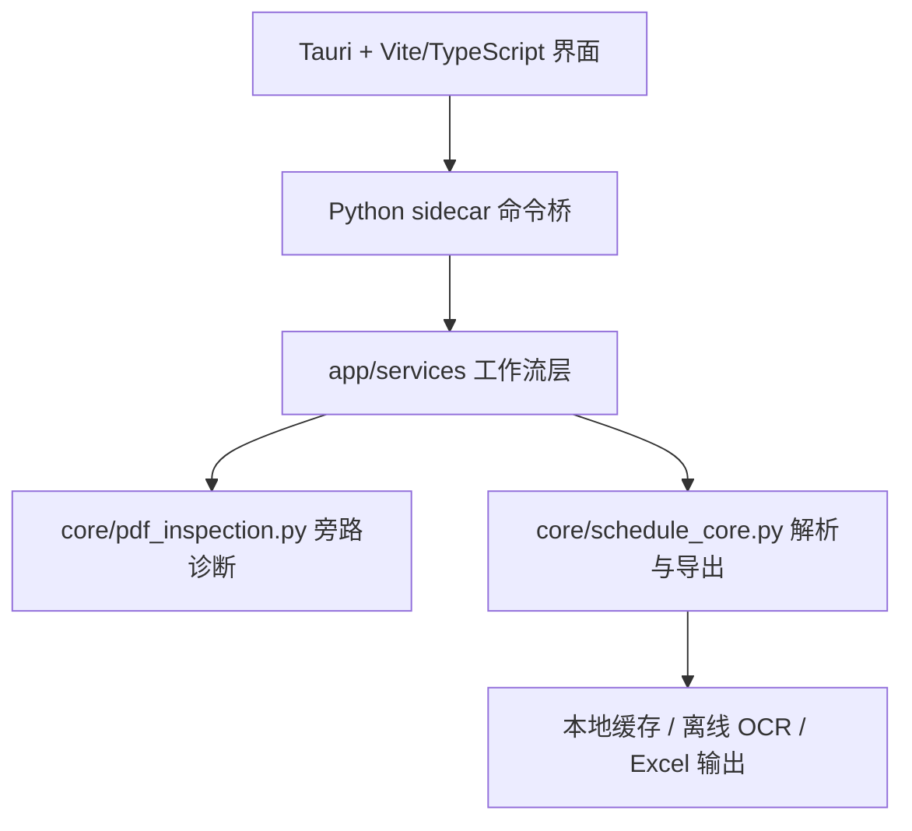

# 空谷 Konggu

<p align="center">
  
</p>

<p align="center">
  面向中英合办学生组织的离线空课生成工具。
  <br />
  批量解析中方、英方课表 PDF，合并课程占用时间，生成可直接用于排班的集体空课表。
</p>

<p align="center">
  
  
  
  
</p>


## 简介

空谷（Konggu）是青禾计划孵化的课表协作产品，服务中英合办和中外合作办学场景里的课表收集、成员排班、志愿服务和值班协作。

它解决的是收课表、看课表、比对节次、统计空闲这堆重复劳动。负责人不用再逐个成员、逐周、逐节核对两套课表，可以把精力从抄表和比表转向真正需要判断与协调的工作。

> 核心判断只有一句话：同一成员只有中方课表和英方课表都没有课，才算真正空闲。

## 目录

- [简介](#简介)
- [为什么需要空谷](#为什么需要空谷)
- [功能](#功能)
- [一个例子看懂](#一个例子看懂)
- [工作流程](#工作流程)
- [界面一览](#界面一览)
- [输入契约](#输入契约)
- [输出](#输出)
- [核心规则](#核心规则)
- [常见问题](#常见问题)
- [当前状态与已知限制](#当前状态与已知限制)
- [快速开始](#快速开始)
- [开发](#开发)
- [技术栈](#技术栈)
- [架构](#架构)
- [离线资源](#离线资源)
- [测试](#测试)
- [项目志](#项目志)
- [项目治理与协作](#项目治理与协作)
- [路线图](#路线图)
- [名称由来](#名称由来)

## 为什么需要空谷

中英合办学生通常同时持有中方课表和英方课表。人工排班时，负责人要逐个成员、逐周、逐节比对两套课表。只看一张课表容易误判：中方没课不代表英方没课。

空谷把这条链路自动化：

```text
收集课表 PDF → 识别成员和课表类型 → 解析课程占用 → 合并中英双课表 → 反推空闲时间 → 导出 Excel
```

适用场景：

| 场景 | 说明 |
| :--- | :--- |
| 值班排班 | 按成员空闲情况安排值班顺序 |
| 活动筹备 | 找出特定时段能到场的人员 |
| 志愿服务 | 从多人双课表中筛选可用人选 |
| 集中会议 | 确认大家共同空闲的时间段 |
| 培训排班 | 分批安排培训而不冲突 |

人工整理这套流程会遇到的问题，以及空谷的对应做法：

| 痛点 | 空谷的做法 |
| :--- | :--- |
| 人工整理耗时高 | 批量解析多名成员课表 |
| 重复劳动价值低 | 自动完成节次比对和名单统计 |
| 中英课表难合并 | 同一成员的中方、英方占用统一计算 |
| 人工统计容易出错 | 缺失、冲突、解析失败都会显性提示 |
| 课表包含个人信息 | 离线 Windows 桌面软件，本地处理 |

## 功能

| 功能 | 说明 |
| :--- | :--- |
| 批量导入 PDF | 一次选择多名成员的课表 PDF |
| 课表类型识别 | 按文件名识别中方、英方；识别不了就拒绝解析，不静默猜测 |
| 文件识别检查 | 在本机判断课表能否直接读取、哪些页面需要图片文字识别 |
| 本地 PDF 解析 | 优先读取文本层，文本不足时回退本地 OCR |
| 双课表合并 | 同一成员的中方、英方课表合并为完整课程占用表 |
| 空课预览 | 按周次、日期、星期、节次展示空闲人数和空闲成员 |
| 成员课表 | 核对每个成员的中方、英方课表是否齐全 |
| 待处理 | 集中显示需要核对或必须修正的内容 |
| 原文核对 | 对照 PDF 原页修正课程时间，修正必须填原因 |
| Excel 导出 | 导出经典空课表，用于排班、值班和志愿服务安排 |
| 离线资源 | 内置配置和 PP-OCRv4 mobile OCR 模型，默认不允许在线下载模型 |

## 一个例子看懂

以四名成员为例，每人交中方、英方两份课表：

```text
张三-中方课表.pdf  张三-英方课表.pdf
李四-中方课表.pdf  李四-英方课表.pdf
王五-中方课表.pdf  王五-英方课表.pdf
赵六-中方课表.pdf  赵六-英方课表.pdf
```

解析后两套课表合并成一张占用表。只看第 1 周周一 3-4 节：

| 成员 | 中方课表 | 英方课表 | 该时段是否空闲 |
| :--- | :--- | :--- | :--- |
| 张三 | 有课 | 没课 | 不空闲 |
| 李四 | 有课 | 没课 | 不空闲 |
| 王五 | 有课 | 没课 | 不空闲 |
| 赵六 | 没课 | 没课 | 空闲 |

只看英方课表，会觉得张三周一 3-4 节有空；合并后才知道中方那两节有课。所以周一 3-4 节能排的人只有赵六。

有人缺英方课表时，先到“成员课表”处理，处理完之前他不会出现在空闲名单里。

## 工作流程


| 阶段 | 数据 |
| :--- | :--- |
| 原始输入 | 成员提交的中方课表 PDF、英方课表 PDF |
| 检查与识别 | 成员姓名、课表类型、PDF 类型、逐页 OCR 建议、PDF 文本或 OCR 文本 |
| 结构化 | 成员、周次、星期、节次、课程占用 |
| 合并占用 | 同一成员的中英双课表占用合集 |
| 空闲结果 | 每个时段的空闲人数、空闲成员、有课成员 |
| 导出 | 可直接用于排班的 Excel 空课表 |

## 界面一览

主窗口分三块：左侧操作区，中间结果区，底部最近操作。界面外壳只初始化一次，处理进度、文件状态和结果内容按区域更新；切换标签时会保留原文核对的页码、缩放、滚动位置，以及课程周视图的当前周和选中状态。

```text
┌─────────────────────────────────────────────────────────────┐
│ 青禾计划 · 空谷                 青心如禾，向阳而生            │
│ 操作：导入课表  生成空课表  重新处理失败文件  导出空课表      │
│ 学期设置：第一周开始日期 / 教学周数   本地识别：就绪 / 需修复 │
├─────────────────────────────────────────────────────────────┤
│ 已选课表：张三-中方课表.pdf  张三-英方课表.pdf …               │
├──────────────┬──────────────────────────────────────────────┤
│ 共同空闲      │ 周次 日期 星期 节次 空闲人数 空闲成员 有课人员│
│ 成员课表      │                                              │
│ 文件检查      │                                              │
│ 待处理        │                                              │
│ 原文核对      │                                              │
│ 课程周视图    │                                              │
├──────────────┴──────────────────────────────────────────────┤
│ 最近操作：空课表已生成，可以导出 …                            │
└─────────────────────────────────────────────────────────────┘
```

六个视图各管一件事：

| 视图 | 核心定位 |
| :--- | :--- |
| 共同空闲 | 看每个时段谁有空、谁有课，判断能不能排 |
| 成员课表 | 核对每个成员的中方、英方课表是否齐全 |
| 文件检查 | 看每个 PDF 识别成谁、哪类课表、识别出多少有课时段 |
| 待处理 | 处理需要核对或必须修正的内容 |
| 原文核对 | 对照 PDF 原页修正课程时间，修正必须填原因 |
| 课程周视图 | 以周课表查看课程，拖拽修正后保留处理记录 |

界面的颜色、层级、最小窗口、组件、动效与无障碍约束见 [`《空谷界面设计规范》`](./docs/界面设计规范.md)。

## 输入契约

空谷优先保证结果可信，输入规则是产品契约，不是建议。

1. 文件必须是 PDF。
2. 文件名必须能看出成员姓名和课表类型。
3. 文件名必须包含“中方”或“英方”。
4. 同一成员应同时提供中方课表和英方课表。
5. 文件名无法识别课表类型时，系统暂停解析，不默认猜测。
6. 已选择的文件若不存在或无法读取，或不同目录中出现同名 PDF，本批结果会标为阻断；请重新选择文件或改为不同文件名后再处理。

推荐文件名：

```text
张三-中方课表.pdf
张三-英方课表.pdf
办公室-李四-中方课表.pdf
办公室-李四-英方课表.pdf
```

不接受：

```text
张三.pdf
课表1.pdf
schedule.pdf
办公室成员课表.pdf
```

## 输出

解析完成后先看三个视图，再导出 Excel。输出用界面里的视图名，跟软件里看到的一致：

| 视图 | 看什么 |
| :--- | :--- |
| 共同空闲 | 哪些周次、日期、星期、节次有多少人空闲，具体是谁 |
| 成员课表 | 每个成员是否同时导入中方和英方课表，有无缺失或冲突 |
| 文件检查 | 每个 PDF 是否识别成功，识别为谁、哪类课表、多少有课时段 |

导出的 Excel 用于实际排班。导出前先处理“待处理”中的异常；仍有必须修正的问题时，导出按钮不可用。

## 核心规则

空谷把复杂异常压缩成四条规则：

| 规则 | 判定 |
| :--- | :--- |
| 身份 | 一个 PDF 必须能关联到成员，并识别为中方或英方课表 |
| 占用 | 每个课程块只表达一件事：某人在某周、某天、某节被课程占用 |
| 完整 | 同一成员需要同时具备中方、英方课表；缺失任一类都必须提示 |
| 空闲 | 某个时段没有课程占用的成员进入空闲名单；存在缺失、冲突或解析失败时显性标记风险 |

这套规则让不同背景的使用者在点击按钮前形成同一理解：空谷不替负责人猜，它只整理可证明的空闲时间，并指出不可信的地方。

## 常见问题

**文件名不规范怎么办？**

改成“姓名-中方课表.pdf”或“姓名-英方课表.pdf”再导入。文件名里看不出课表类型时，空谷会暂停解析并列出问题文件，不会替你猜。

**提示离线材料不完整怎么办？**

空谷启动时会自动从安装包内置资源校验并恢复本地识别材料，正常情况下不需要手动操作。只有自动恢复失败时，才点击“修复识别功能”重试。Windows 用户目录包含中文时，OCR 模型会自动放到纯英文的 `%PROGRAMDATA%\Konggu\ocr_models`，避免 Paddle 无法读取非 ASCII 路径；显式设置的 ASCII `KONGGU_OCR_MODEL_DIR` 仍优先使用。开发环境可以先用 `npm.cmd run prepare:offline:dev` 跳过 OCR 模型。

**课表会传到网上吗？**

不会。空谷是离线桌面软件，PDF 只在本地读取，默认禁止模型联网下载。

**能导出什么格式？**

目前导出经典空课表 Excel（xlsx）。可视化样式导出还在暂缓清单里。

**有人只交了一份课表怎么办？**

“成员课表”会标出缺哪一类。导出前处理完，否则他的空闲时间不作数。

**解析结果看着不对怎么办？**

到“原文核对”先看文件形式、图片识别页和文字读取情况，再对照原页修改课程时间。改完必须填原因，改动会保留记录。

## 当前状态与已知限制

| 项目 | 状态 | 说明 |
| :--- | :--- | :--- |
| 0.5.16 阶段 0 交付修复 | 在研（本地提交、未推送；离线候选包已构建） | 修复同名成员导出合并导致空闲人数少算、侧车重启后“重新处理本批课表”必失败、人工修正已保存却提示失败并回滚；另修学期设置静默清空结果与修正、原文核对坐标生产端、请求超时分级。Python 317 passed、TypeScript、Vite 通过。0.5.10 陈旧安装包已隔离作废。正式离线候选包 `Konggu_0.5.16_x64-setup.exe`（533,364,215 字节，SHA-256 `07D955E5…`）已构建，发布静态门禁 **30/30 通过**，存放于 `build/candidates/0.5.16-offline/`；因本机网络策略拦截微软下载，WebView2 离线安装器取自本机官方缓存并配合同版本自定义 NSIS 模板，临时配置已还原。打包 worker 与 Tauri 启动冒烟通过；NSIS 安装、断网、跨机与代码签名未验收。 |
| 0.5.15 中方图片裁切预检 | 历史在研基线（35 组原件流程已验证） | 以星期表头列距和页底表格线判断截图裁切。解析签名 53 重跑得 9346 块、候选独有 516、程序独有 586；29 blocked、6 needs_review、0 accepted。已知 7 份截断中方原件全部报裁切阻断；课程占用格与签名 52 逐格一致。 |
| 0.5.14 整学期“校外”与英方续页错位修复 | 历史在研基线 | 结合星期表头、课程标记与图例排除“校外”整日误占用；英方图片页补单个缺失日期行并收紧末行范围。解析签名 52 重跑得 9346 块、候选独有 516、程序独有 586；28 blocked、7 needs_review、0 accepted。 |
| 0.5.13 双列截图与“校外”占用修复 | 历史在研基线 | 手机双列周表限定各周星期列、识别单节课程并过滤单字噪声；旧版网页及整学期视觉表格排除地点以“校外”开头的课程。解析签名 50 当时实跑得 9374 块、候选独有 503、程序独有 601；28 blocked、7 needs_review、0 accepted。 |
| 0.5.12 图片课表时间与合并格修复 | 历史在研基线 | 手机周课表 OCR 连写时间按坐标拆分；图片型网页课表结合原页分隔线与文字跨界证据补全 83 个合并格占用槽。签名 47 的应用实跑为 9402 块、候选独有 499、程序独有 625。 |
| 0.5.11 课表对比修复 | 历史在研基线（真实原件流程已验证） | 35 组春季原件与逐人候选对比后，英方文本表格改用单元格边框识别跨节课，处理重复表头和续页；中方文本表格优先使用原页竖线定位并保留弱版式回退；PDF 绘制超页、图片型中方完整性和英方午间无时钟占用进入质量门禁。签名 45 实跑 9319 个课程块，候选独有格从 1548 降至 507，应用独有格从 729 降至 550；28 blocked、7 needs_review、0 accepted。当时 30 号英方截图尚有 6 格漏读，187 条午间无编号候选未进入有编号比较。逐人候选不是完整人工真值，不计算准确率或生成正式空课。 |
| 单元测试 | 已验证 | 317 passed（2026-10-23，0.5.16 工作区，项目虚拟环境） |
| TypeScript / 前端构建 | 已验证 | 本地 `tsc --noEmit` 与 `npm.cmd run build:frontend` 通过（0.5.16、47 modules） |
| 桌面层检查 | 已验证 | `cargo check --manifest-path src-tauri\Cargo.toml --locked --offline` 通过 |
| 真实样本页级诊断 | 已验证 | 仓库外 70 份、109 页；PDF Inspector 与 PyMuPDF 的无文本层页集合一致 |
| 课程块人工真值 | 未验证 | 受控目录保留原页 AI 核对与独立几何候选；6 份完成占用 AI 视觉核对，其余仍待核。AI 标注不等于独立人工真值，不计算准确率 |
| 0.5.10 图片课表识别修复 | 已验证（程序回归与候选工作簿；非课程准确率） | 复用同页后续重复表头找回首段英方课程，扩展星期/日期纵向配对并用日历星期校验；签名 40。70 份原 PDF 哈希核验后重解析得 8457 个程序块；35 人 v1.7 候选含 9463 条占用，7 组 blocked、28 组 needs_review，不生成正式空课。真实 OCR 引擎未在该次重解析中重新验收 |
| 0.5.9 代码审计修复 | 已验证（源码、全量回归与仓库外样本只读冒烟） | 修复正式导出必败（`periods` 列表单元格）、任务进度错行、取消/重启竞态、sidecar stdin 编码、评审写入原子性、共同空闲显示内部成员标识、离线清单失败开放、发布门禁缺版本与清单校验、解析缓存未含学期设置（签名升至 39）等 49 项问题；`pytest 286 passed`、`tsc --noEmit`、Vite 构建、Cargo locked check 与发布静态门禁通过；未构建安装包 |
| 0.5.9 真实样本全量重跑 | 已验证（流程与结构，非准确率） | 签名 39 下仓库外 70 份 PDF：70/70 成功、解析异常 0、8378 个课程块（中方 7485、英方 893）、日期一致性 100%；图片型 17 份走真实 OCR/视觉表格（2281 块、0 异常）。按文件名身份 32 组为 9 accepted/23 needs_review/0 blocked；按正文姓名补齐 35 组为 9/23/3（3 组文件名身份不一致被拆单边）；9 组 accepted 真实导出成功（28 表/份），23 组 needs_review 正确拒绝。与 0.5.7 的 8435 块基线差 −57 块，不构成准确率结论；OCR 准确率、Excel 实际渲染与安装态仍未验证 |
| 0.5.7 课程简称过滤 | 已验证（源码与解析回归） | 保留带数字的课程简称，地点以“校外”开头的课程不计入；签名 38。70 份原件哈希核验后重跑，8435 条程序占用、解析异常 0；17 份复用匹配哈希的原始 OCR 文字坐标，未重验 OCR 准确性。7 份中方原件截断按问题课表保留，审计几何识别尚未集成至应用。当前审计口径为 7 组 `blocked`、28 组 `needs_review`、0 组 `accepted`；旧 15/17/3 属 0.5.5 流程状态 |
| 0.5.8 结果安全修复 | 已验证（源码、前端契约与缓存回归） | 共同空闲改为每页 800 行显式分页（不再静默截断）；原文核对销毁时释放点击监听；重试与换文件清空旧结果和旧任务；修正/设置失败可见；失败态不渲染阿谷；周视图注册中文 locale；OCR 文字缓存校验引擎与模型。午间口径经用户确认：中方“午”列不排课、不计占用，英方午间有课应计入。当前 0.5.11 已能识别无编号午间占用，但原页未给出其准确时钟时先阻断正式空课，仍待建立可靠时间映射。`200 passed` 为当时回归记录 |
| 0.5.3 离线安装包 | 已构建、已静态核验、未签名 | 历史记录为 `Konggu_0.5.3_x64-setup.exe`，531,812,144 字节，SHA-256 `95C81B5B205D2106D2DC43D3C81569B04934A85DB587F48858D63BC93FAE6920`；2026-09-13 本机现存同名产物为 532,487,843 字节、SHA-256 `E2C79321E1019FA95F608DFC1984469D6085B3298B595403E906CF65D800FF80`，重建后未回写记录，引用前需按现存产物复核；WebView2 Standalone Runtime 随 NSIS 安装包嵌入 |
| 0.5.4 中文用户名 OCR 修复 | 已验证（源码、回归与隔离运行） | 中文应用数据路径下自动改用 `%PROGRAMDATA%\Konggu\ocr_models`，真实 PaddleOCR 初始化返回 `ready: true`；状态面板区分路径不兼容、模型缺失和校验失败；尚未构建 0.5.4 安装包 |
| 0.5.5 结果可信度修复 | 已验证（源码、合成及 35 组真实配对流程回归） | 缺失/同名文件阻断、节次规范化、人工修正后重算与签名构建失败码修复；0.5.5 流程下 35 组为 15 `accepted`、17 `needs_review`、3 `blocked`（历史状态，0.5.7 已重新审计为 7/28/0），不可按旧登记分类放行 |
| 0.5.6 跨年识别修复 | 已验证（源码、合成及两份既有 PDF 副本的流程回归） | 无年份日期按学期配置及表内周次确定年份；秋季跨年和新学期英方日期网格回归通过，解析器签名升至 36。两份中英 PDF 副本重跑得到 92 条占用、解析错误 0；原件对应关系、真实跨年样本与安装包尚未验证 |
| 0.5.5 离线安装包 | [GitHub 预发布候选](https://github.com/GinFJ/KongGu/releases/tag/v0.5.5-rc.1)、未签名 | `Konggu_0.5.5_x64-setup.exe`，532,483,538 字节，SHA-256 `A3F5987E01A3A2618C47C3DF36C2B3D343A9F97738C254DEE8790CFB9D789BA3`；当前电脑 release 主程序已验证导入、解析和待复核门禁；同页提供 OCR 诊断工具包 |
| 代码签名 | 在研 | `build-release-signed.ps1` 已接入安装器、`konggu.exe` 和 `konggu-worker.exe`；当前机器缺少受信任发布证书，正式签名构建被安全门禁阻止 |
| 真实安装与断网终检 | 未完成 | 尚未在另一台电脑完成 NSIS 安装、断网导入导出、卸载、WebView2 和用户数据库迁移复核 |

已知限制：

- 2026-10-23 的离线候选包因本机网络策略拦截微软下载，WebView2 离线安装器取自本机官方缓存（SHA-256 `0625FB5C…`）并配合 Tauri CLI 2.11.4 同版本自定义 NSIS 模板构建，临时配置已还原；网络放行后可用标准 `offlineInstaller` 流程复现同一产物。
- 版式识别以中英合办常见课表为主，没覆盖到的版式会进入“待处理”，不会静默放行。
- 当前只导出经典空课表；可视化样式、复杂筛选在暂缓清单。
- PDF Inspector 当前只提供旁路诊断，不直接改变课程块、OCR 路由或质量门禁；已完成 70 份真实样本的页级文本层对账，仍需课程块人工真值与缓存失效回归后再决定是否启用逐页 OCR。
- 未解决的异常会阻止正式导出，这是有意的。

## 快速开始

### 使用

1. 收集成员课表 PDF。
2. 按输入规则整理文件名。
3. 打开空谷。
4. 检查“本地识别”状态；如提示缺失，点击“修复识别功能”。
5. 选择所有课表 PDF。
6. 确认文件列表中每个文件都能识别出中方或英方。
7. 设置第 1 周周一和导出周数。
8. 点击“生成空课表”。
9. 先处理“待处理”里的异常。
10. 点击“导出空课表”，用于排班。

### 环境搭建

```powershell
python -m venv .venv
.\.venv\Scripts\Activate.ps1
python -m pip install --upgrade pip
python -m pip install -r requirements.txt
npm.cmd install
npm.cmd run dev
```

## 开发

<details>
<summary>开发命令：测试、构建、离线资源准备与安装包</summary>

Python 测试：

```powershell
python -m pytest -q
```

前端构建：

```powershell
npm.cmd run build:frontend
```

联网环境准备离线资源：

```powershell
npm.cmd run prepare:offline
```

开发阶段 OCR 模型暂时缺失时：

```powershell
npm.cmd run prepare:offline:dev
```

构建 Windows 安装包：

```powershell
npm.cmd run build
```

构建会先打包 Python sidecar，再按 Tauri 需要的二进制名复制。

正式签名构建（需要已安装到 Windows 个人证书存储、带私钥且受信任的代码签名证书）：

```powershell
$env:KONGGU_SIGN_CERT_THUMBPRINT = "<证书 SHA-1 指纹>"
npm.cmd run build:release:signed
```

该命令会先签名 `konggu-worker.exe`，再由 Tauri 签名主程序和安装器，最后使用 `signtool verify /pa` 复核三类产物。未提供受信任证书或证书为自签名证书时，命令会主动失败，不会生成可冒充正式发布的签名包。

只测试 Python sidecar：

```powershell
python -m app.sidecar --request-json "{\"command\":\"resources.status\"}"
```

</details>

## 技术栈

| 层 | 选型 | 用途 |
| :--- | :--- | :--- |
| 桌面壳 | Tauri 2 | Windows 桌面窗口与命令桥 |
| 前端 | Vite + TypeScript | 界面与状态管理 |
| 课表日历 | FullCalendar 6 | 课程周视图与拖拽修正 |
| PDF 渲染 | pdfjs-dist | 复核页原页渲染与课程块定位 |
| 解析引擎 | Python 3.12（PyInstaller 打包） | 文本层、版式识别、课程结构化、合并与导出 |
| PDF 文本 | PyMuPDF | 读取 PDF 文本层 |
| PDF 结构诊断 | pdf-inspector 0.2.6（Firecrawl，MIT） | 本地分类、逐页 OCR 原因、编码和复杂版式提示 |
| OCR | PaddleOCR（PP-OCRv4 mobile，CPU） | 文本层不足时的本地识别 |
| 表格处理 | pandas | 占用合并与统计 |
| Excel 导出 | openpyxl | 生成经典空课表 |

## 架构



| 路径 | 职责 |
| :--- | :--- |
| `src/` | 桌面界面、文件选择、解析前校验、结果预览 |
| `app/sidecar.py` | Tauri 调用的命令入口 |
| `app/services/` | 工作流编排、成员检查、预览、导出、序列化 |
| `core/` | PDF 解析、OCR 回退、课程块、占用表、Excel 工作簿 |
| `config/` | 日历、节次时间、OCR 模型与参考库配置 |
| `resources/` | 内置离线清单与 OCR 模型目录 |
| `src-tauri/` | Tauri Windows 桌面壳 |
| `tests/` | 业务规则、工作流、导出与资源检查 |

## 离线资源

发布包应包含：

```text
config/
assets/
resources/offline_manifest.json
resources/ocr_models/PP-OCRv4_mobile_det
resources/ocr_models/PP-OCRv4_mobile_rec
```

运行时，空谷会把资源校验并复制到用户可写的应用数据目录：

```text
%LOCALAPPDATA%\Konggu\resources
%LOCALAPPDATA%\Konggu\ocr_models
%PROGRAMDATA%\Konggu\ocr_models  # Windows 中文用户名下的 OCR 兼容目录
%LOCALAPPDATA%\Konggu\cache
%LOCALAPPDATA%\Konggu\logs
```

默认关闭 PaddleOCR 模型下载。启动时会从安装包内置资源自动初始化本地 OCR 模型；中文用户名导致 `%LOCALAPPDATA%` 无法用于 Paddle 时，自动改用 `%PROGRAMDATA%\Konggu\ocr_models`。模型校验仍失败时，使用界面中的“修复识别功能”重试；状态面板会区分路径不兼容、模型缺失和校验失败。

## 测试

最近一次代码验证（2026-10-23，0.5.16 当前工作区）：

```text
317 passed
```

签名 53 的应用已从 35 组原始 PDF 重新执行解析、合并、质量判断，并与逐人候选 v1.7 对比；已核验来源哈希并复用本地原始 OCR 坐标观察。候选不是完整人工真值；安装态、正式空课、课程准确率与真实跨年样本仍未验证。

主命令：

```powershell
.\.venv\Scripts\python.exe -m pytest -q
```

异常矩阵见 [`docs/exception-test-matrix.md`](./docs/exception-test-matrix.md)。真实成员课表应放在版本库外，通过脱敏样本库测试。最新状态以 `docs/状态与质量门禁.md` 与 `MEMORY/事实.md` 为准。

## 项目志

项目从 V0.1、FastAPI 本地 Web、Web-only 收缩，到离线 Tauri 桌面端、0.3.0 和解析审计基线的完整沿革，记录在 [`《空谷项目志》`](./docs/PROJECT_CHRONICLE.md)。

## 项目治理与协作

长期工作规则见 [`AGENTS.md`](./AGENTS.md)，动态记忆（事实、决策、待办）见 [`MEMORY/`](./MEMORY/MEMORY.md)，参考资料库见 [`resources/reference/`](./resources/reference/README.md)，项目说明与质量门禁见 [`docs/项目说明.md`](./docs/项目说明.md) 与 [`docs/状态与质量门禁.md`](./docs/状态与质量门禁.md)，界面约束见 [`docs/界面设计规范.md`](./docs/界面设计规范.md)，测试分层见 [`tests/README.md`](./tests/README.md)。

## 路线图

### 近期重点

- 为正式样本库建立课程块人工真值和可脱敏固化的回归子集
- 逐项补齐真实 Tauri 的 accepted / needs_review / blocked / 原文核对 / 导出状态截图与 Windows 辅助功能检查
- 完成隐私与发布检查（真实姓名、路径、联网行为）
- 确认正式导出的工作表与字段

### 保留

- 批量 PDF 导入
- 双课表合并
- 成员完整性检查
- 异常状态显性展示
- 空课预览
- 经典 Excel 导出
- 离线 OCR

### 暂缓

- 可视化 Excel 样式导出
- 复杂筛选
- 云同步
- 成员数据库
- 活动报名
- 考勤统计

### 不做

- 文件名不清晰时猜测课表类型
- 导出隐藏解析失败的结果
- 用日志代替面向用户的提示

## 名称由来

空谷是青禾计划孵化的课表协作产品。

- “空”指空课表。
- “谷”承接青禾从禾苗生长为谷物的意象。

空谷在本地生成空课结果，每个 PDF 的来源和人工修正过程都可以回查。

## 认识阿谷

<p align="center">
  
</p>

阿谷是空谷的非人虚拟形象，是一只向着阳光生长的谷物精灵。双叶冠承接青禾，腹部透明种仁代表“青心”，圆润谷粒身体对应青禾最终生长为谷物的意象。

> 青心如禾，向阳而生。

桌面端中的阿谷会按界面状态执行不同动作：欢迎时蓄力跑动并挥手，处理中以有接触感的步态提示进度，可信完成时播放一次庆祝；减少动态效果时自动退化为静态姿态。角色母版、动作边界、头像、应用图标、启动页和宣传材料规范见 [`《阿谷角色与视觉使用规范》`](./docs/品牌/阿谷角色与视觉使用规范.md)。

---

最后更新：2026-10-18
