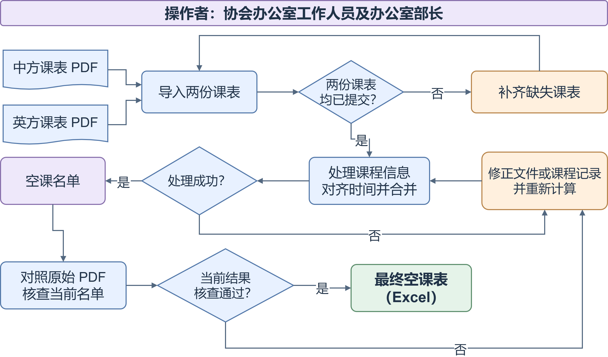

# 空谷 Konggu

<p align="center">
  
</p>

<p align="center">
  面向中英合办学生组织的空课生成工具，默认本地处理。
  <br />
  批量读取中方、英方课表 PDF，合并课程占用，核对后导出集体空课表。
</p>

<p align="center">
  
  
  
  
</p>


<p align="center">
  <a href="#开始使用">开始使用</a> ·
  <a href="#工作流程">工作流程</a> ·
  <a href="#如何判断空课">合并规则</a> ·
  <a href="#常见问题">常见问题</a> ·
  <a href="#开发">开发</a>
</p>

空谷是青禾计划孵化的课表协作产品，面向需要汇总多人中方、英方课表的学生组织。它读取成员提交的 PDF，合并两边的课程，再按周次和节次列出没有课的成员，核对后导出 Excel。

**0.14.0 支持在本机接着制作课表。** 完全退出后，再次打开空谷会列出已经生成的各批课表，也可以继续上次草稿或新建合表。平时从左侧「本机课表记录」进入，可以查看占用空间、单独清理识别缓存。导入、核验、保存和导出都可离线使用，无需登录。[本机课表历史使用说明](docs/本机课表历史_0.14.0.md)

## 工作流程

[](docs/images/readme/konggu-workflow.png)

以协会办公室为例，工作人员导入课表、处理问题，对照原件核查名单后导出。

## 为什么做空谷

项目来自学院青协办公室制作成员空课表的经历。工作人员要逐个打开中方、英方课表，把每一节没课的人名抄进 Excel。复查时，既发现过有课的人被列入名单，也发现过没课的人被漏掉；检查一个名字，又要回到两份原课表里找。

空谷读取、比对和汇总课表，工作人员对照原件逐项核验课程，处理缺件和识别疑点。导出后，负责人可以按任务时段找人，再联系成员确认安排。

- 一次导入多人的课表，检查成员身份及中方、英方配对是否完整。
- 按周次和节次合并课程，查看每个时段的空闲人数和名单。
- 从存疑的记录回到 PDF 原页，修正后重新计算。
- 核对后导出 Excel，保留来源、问题和修正记录。

## 开始使用

空谷桌面版面向 Windows 10/11 x64。已有桌面版的制表人可直接在本机导入。开发者可从源码构建桌面版，GitHub 已发布的安装包按版本列在 Releases 页。[从源码运行](#本地运行) · [GitHub Releases](https://github.com/GinFJ/KongGu/releases)

### 准备课表

每位成员需要提供同一学期的中方、英方两份 PDF。文件名要包含成员姓名，以及“中方”或“英方”，例如下面的命名格式（将“成员姓名”换成实际姓名）：

```text
成员姓名-中方课表.pdf
成员姓名-英方课表.pdf
办公室-成员姓名-中方课表.pdf
办公室-成员姓名-英方课表.pdf
```

只有“课表.pdf”或“schedule.pdf”这样的文件名，无法确定成员和课表类型，需要先改名。不同目录中的同名 PDF 也需要区分。如果文件名与课表正文里的姓名不一致，应先确认归属。

缺少一方课表、文件损坏或课表被截断时，请补齐或更换原件。这些问题解决前，不能把未识别到的课程当作空闲时间。

### 导入和生成

1. 打开空谷，等待左侧“本地识别”显示已就绪。
2. 在“课表资料”中导入成员的 PDF，检查文件名及中方、英方分类。
3. 展开“学期设置”，按校历填写第一周开始日期（周一）和教学周数，保存设置。
4. 填好“本次合表日期”，点击“识别并核对”。所有成员共用这段日期，开学或放假当月可以只选其中几天。
5. 在中间切换当前成员的中方、英方原表，按周翻看。点多识别的色块取消该节，点漏识别的空格补课。版式无法确定节次时，在点过的位置选日期和节次。
6. 在右侧处理课表问题。原件只覆盖部分日期时，先到其他渠道核实，按需补课，勾选已核实后点击确认。右下角可以翻看连续多次操作。
7. 最后一名成员确认、阻断问题处理完后，进入“空课结果”。点时段可以查看名单，选择部门和模板即可导出最初选定的日期。

以前创建并保存的逐项核验批次，重新打开时沿用创建时的核验方式。[日期批次原表核对](docs/交付验收_0.13.0_v1.0.md) · [历史批次逐项核验](docs/交付验收_0.10.0_v1.0.md)

## 结果与核对

制表时会用到三个工作区。

| 工作区 | 用途 |
| --- | --- |
| 课表资料 | 导入与生成，查看文件检查、成员课表和课程占用周视图 |
| 课表核验 | 检查整批人数与配对，在原表上逐节修正，再逐人确认 |
| 空课结果 | 选部门和周次，查看空闲人数、名单，通过检查后按模板导出 |

## 如何判断空课

同一成员、同一教学周、同一节次，只要中方或英方任意一边有课，就不列入空课名单。两份课表都成功读取、相关问题已解决，并且该节都没有课，才列入名单。缺交或读不清的部分保留为待解决问题。

<details>
<summary>查看双课表合并规则图</summary>

[](docs/images/readme/konggu-merge.png)

</details>

识别完成后，结果有三种状态：

| 状态 | 含义与处理方式 |
| --- | --- |
| `accepted` | 解析质量检查通过。新批次还需全员确认，并通过实时来源、学期和签名检查才能导出 |
| `needs_review` | 有图片识别、课程时间等内容需要核对，处理完才能正式导出 |
| `blocked` | 有缺失、身份冲突、解析失败或学期范围错误，需要先补文件、改设置或修正结果 |

日期批次在原件上改一节，只影响当前成员、来源和当天的该节。已确认的成员有改动时要再次确认。历史批次的逐条核验和课程修正见[原流程使用说明](docs/人工修正使用说明_0.8.0.md)。

### 选择 Excel 模板

| 模板 | 适用场景和内容 |
| --- | --- |
| 青禾排班周表 | 给部门排班或打印。每周一张，只列所选日期，含范围内的周末。列出整个大节都空闲的成员，包含午间和晚间。旧批次仍提供青禾工作日周表。 |
| 完整明细工作簿 | 内部核对，含周表、逐节空闲与占用名单、课程明细及来源记录。选择单周后，时段和课程明细限于该周，名册、来源及核验记录保留本次所选范围。 |

选择部门后，人数与名单按该部门的成员身份重新计算。同名成员按各自身份归属。部门工作簿仅写入能唯一归属于该部门的结构化核对信息。

## 常见问题

<details>
<summary>本地识别服务启动失败</summary>

识别程序启动时需要解压文件，临时目录至少要有 1 GiB 可用空间。默认位置空间不足或不可写时，空谷会尝试其他本地固定磁盘。请按窗口提示处理空间或权限问题，再点击“重新启动识别服务”。

如果提示识别材料缺失或校验失败，可以在“本地维护”中点击“修复识别功能”，从安装包内置资源恢复。提示安装组件异常时，需要使用完整安装包重新安装。

</details>

<details>
<summary>本机课表能保留多久？清缓存会影响核验进度吗？</summary>

0.14.0 新生成的课表及核验进度一直保留到你主动清除。升级后尚能在列表中看到的旧版课表，打开一次也会按这个规则保留。未生成的草稿保留 30 天。如果启用了「记住原件位置」，位置也保留 30 天。以后要翻原页时，可以点「关联原件」重新选择 PDF。

「本机存储」分别显示识别缓存的大小及文件数、记录数据库的大小及批次数。「清除识别缓存」会保留课表和核验进度。「清除全部本机记录」需要再次确认，会同时清除当前工作区的历史、草稿、核验修正及缓存。原始 PDF 和已导出的 Excel 均保留。[本机历史与清理](docs/本机课表历史_0.14.0.md)

</details>

<details>
<summary>换电脑能接着做吗？资料何时会联网？</summary>

本机历史保存在同一台电脑的 Windows 用户和空谷工作区中。需要跨电脑制作时，可以自行部署账号服务，在两台电脑连接同一服务，并把要接着做的批次存入账号。云端保存结构化结果和核验进度，查看原页时在新电脑关联原始 PDF。[账号与云端批次](docs/云端批次_0.12.0.md)

课表识别默认在本机完成。可选的 AI 原页核对会在你预览、按需遮盖并同意发送后，将选定页面图片发送给 OpenAI。返回的差异需要对照原件核实。[AI 原页核对说明](docs/AI识别使用说明_0.9.0.md)

</details>

<details>
<summary>课程周次超出了学期范围</summary>

在“课表核验”找到“先核对学期日期”，点“核对这门课”查看具体成员、课程和原页。如果校历的第一周周一或教学周数与设置不同，点“前往学期设置”，改完选择“保存并重新生成”。如果设置符合校历，回原件核对课程记录。空课结果的可预览周次取决于整批原件共同覆盖的工作周。

</details>

<details>
<summary>课程时间识别错了</summary>

在“原文核对”中打开对应 PDF。已有课程可修改时间或删除误识别记录；漏课可补录；带原图区域证据的自动误排除可恢复为课程。填写原因后，预览和空闲结果自动重算，导出包含修正历史。原件本身缺页、损坏或归属不明时，仍需换原件或确认身份，不能用补录直接绕过阻断。

</details>

<details>
<summary>能否导入图片或其他学校的课表</summary>

当前入口接收 PDF，PDF 内的图片页可以走本地 OCR。识别规则主要依据现有中方、英方课表编写，新版式仍可能识别不完整，需要对照原件检查。

</details>

## 版本与已知限制

当前源码和已在本机验证的 Windows x64 桌面版均为 **0.14.0**。用两批合成课表验证了完全退出后选择旧批次、保留成员确认、清缓存后再次打开并导出 Excel。Windows 安装向导、另一台电脑的升级及物理断网仍待实测。[0.14.0 验收范围](docs/本机课表历史_0.14.0.md) · [历史版本变更](docs/变更记录.md)

英方午间课程通过完整时间轴与课程格边界校验映射到 12:40–13:25、13:30–14:15；无法可靠映射时提示复核。详情浮层只有在原 PDF 底层完整空格得到核实时才消除误报；图片遮挡、未配对日期和文字不完整继续保留相应门禁。验证数量与范围见交付记录，不作为未见课表或整学期准确率。

可生成空课的周次受原件实际日期范围限制。查询结束后额外显示的空白行不能用来证明某人无课。已见版式的识别和导出结果可在相应版本的验收记录中查阅。[样本回归与边界](docs/交付验收_0.8.0_v1.0.md)

## 开发

桌面端使用 Tauri 2 和 TypeScript，Python 3.12 负责课表处理。PDF 文字层由 PyMuPDF 读取，图片识别使用本地 PaddleOCR / PP-OCRv4 mobile 模型，Excel 由 openpyxl 生成。依赖版本以 `package-lock.json`、`requirements.txt` 和 `src-tauri/Cargo.lock` 为准。

<details>
<summary>查看本机处理流程图</summary>

[](docs/images/readme/konggu-architecture.png)

这张图说明数据和核查步骤。界面、工作流服务与解析代码的具体位置见下方目录表。

</details>

### 本地运行

开发环境需要 Node.js、Python 3.12，以及可编译 Tauri Windows 项目的 Rust/MSVC 工具链。以下命令在项目根目录的 PowerShell 中执行；安装依赖和首次下载 OCR 模型需要联网。

```powershell
python -m venv .venv
.\.venv\Scripts\python.exe -m pip install -r requirements.txt
npm.cmd ci
.\.venv\Scripts\python.exe tools\prepare_offline_resources.py --download-ocr
```

只查看前端时，运行 `npm.cmd run dev:frontend`。普通浏览器无法调用本地识别功能。

如需桌面调试，先运行 `npm.cmd run build:sidecar`，将新生成的候选目录中 `binaries/konggu-worker-x86_64-pc-windows-msvc.exe` 放入 `src-tauri/binaries/`，再运行 `npm.cmd run dev`。完整安装包使用下方的 `npm.cmd run build` 单独构建。

### 检查与构建

```powershell
# Python 测试
.\.venv\Scripts\python.exe -m pytest -q

# TypeScript 检查与前端构建
npx.cmd tsc --noEmit
npm.cmd run build:frontend

# 桌面层检查
cargo check --manifest-path src-tauri\Cargo.toml --locked

# 提交前隐私检查
.\.venv\Scripts\python.exe tools\check_repo_privacy.py

# Windows 离线安装候选
npm.cmd run build
```

安装包构建还需要本地 NSIS 和 WebView2 离线安装器等资源，准备及检查逻辑见[构建脚本](scripts/build-candidate.ps1)。受信任证书签名使用 `npm.cmd run build:release:signed`，配置见[签名脚本](scripts/build-release-signed.ps1)。

测试分层和真实样本回归方法见[测试说明](tests/README.md)。真实课表放在版本库外，提交测试数据时使用脱敏材料。

### 代码目录

| 目录 | 内容 |
| --- | --- |
| `src/` | 桌面界面、PDF 核对和课程周视图 |
| `src-tauri/` | Windows 窗口、进程启动和安装配置 |
| `app/` | Python 命令接口与工作流服务 |
| `cloud_service/` | 可选的自托管制表人账号和云端批次服务 |
| `core/` | 课表解析、占用合并、质量检查和导出相关逻辑 |
| `config/` | 日历配置与版式、节次、OCR 元数据；实际消费范围见配置说明 |
| `resources/` | 离线资源清单与 OCR 模型；参考资料在 `reference/` 子目录 |
| `tests/` | 业务规则、工作流和回归测试 |

### 离线资源

安装包包含 OCR 模型和配置。启动时，空谷会校验资源并复制到可写目录，默认不允许运行时下载模型。

```text
%LOCALAPPDATA%\Konggu\resources
%LOCALAPPDATA%\Konggu\ocr_models
%LOCALAPPDATA%\Konggu\cache
%LOCALAPPDATA%\Konggu\logs
```

Windows 用户目录含中文、Paddle 无法读取模型时，会改用 `%PROGRAMDATA%\Konggu\ocr_models`。开发者显式设置的 ASCII 路径 `KONGGU_OCR_MODEL_DIR` 优先使用。

## 其他文档

- [项目说明](docs/项目说明.md)与[质量门禁](docs/状态与质量门禁.md)：业务范围、结果状态及导出条件。
- [变更记录](docs/变更记录.md)与[项目志](docs/PROJECT_CHRONICLE.md)：各版本修改和历史验证记录。
- [项目总览](MEMORY/MEMORY.md)与[待办](MEMORY/待办.md)：当前进度和未完成事项。
- [协作规则](AGENTS.md)与[参考资料](resources/reference/README.md)：开发约定、样例和历史材料。
- [界面设计规范](docs/界面设计规范.md)：界面布局、交互和视觉约定。
- [配置与持久化边界](docs/配置与持久化边界.md)：配置是否真正影响运行、数据保留和清理范围。
- [图表来源与可编辑文件](docs/README素材与参考.md)。

## 阿谷

<p align="center">
  
</p>

“空”指空课表，“谷”承接青禾从禾苗生长为谷物的意象。阿谷是空谷的谷物精灵形象。造型与动作规范见[阿谷角色与视觉使用规范](docs/品牌/阿谷角色与视觉使用规范.md)。

---

文档更新于 2026-11-26。
