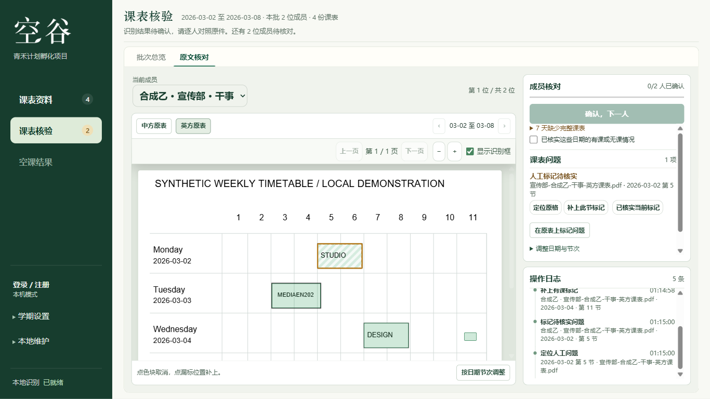

# 空谷 0.13.0 原表核对工作台

## 本机交付

本机交付目录为 `build/candidates/0.13.0-windows/`。免安装版入口为 `portable/konggu.exe`，Windows x64 安装包为 `Konggu_0.13.0_x64-setup.exe`。安装包为 539,541,575 字节，SHA-256 为 `b9526d327bdc5e190d04e0824c67e9088e79aa6a712e164931dc7fd0fdc5e3e2`。

本次打包通过源码与识别进程版本一致性、离线 OCR 资源、内置 WebView2 运行时及安装清单检查。从安装包提取的程序、识别进程和资源共 33 份文件，其内容哈希与原生窗口验收使用的文件逐一相同。

## 制作一批空课表

1. 在“课表资料”核对学期设置，导入本次参与排班成员的课表。填好开始和结束日期。两端都包含在内，同一批所有成员共用该范围。
2. 点“识别并核对”。在中间看成员提交的原始 PDF，切换中方、英方或查看周次。半透明色块表示来自当前原件的有课记录。可以暂时隐藏标记，对照纸面。
3. 点多出来的色块取消该节，点漏掉的空格补上有课。连堂课重叠在同一个框内、扫描件缺少清晰行列等情况下，点原位置后，在右侧选具体日期和节次。再次操作同一节可以改回。
4. 在右侧查看当前成员的问题。对某节拿不准时，点“在原表上标记问题”再选中该节。稍后可从问题列表定位原件，保留原判或修改标记并解决。还有疑点时，该成员保持待确认。资料缺几天时，先核实、按需补课，再勾选已核实。确实无课的日期也可以确认。右下日志可以向上翻看本批人员的操作。
5. 确认当前成员后，继续下一人。若重新修改一名已确认成员的占用，须再次确认该成员。全部成员确认并处理完阻断问题后，打开“空课结果”，选部门和 Excel 模板，保存文件。

## 恢复与原件

重新打开同一份本地工作区会恢复批次起止日期、已确认成员、单节修正和确认记录。原件已移动时，用“重新关联原件”选回与导入时内容相同的 PDF。旧版逐项核验批次仍按当时的核验方式继续。

日期范围以第一次选定的校历日期为准。整批使用 11 月 30 日至 12 月 4 日时，导出只含这五天。青禾排班周表按所选日期排版，完整明细工作簿提供时段、名单和课程明细。单个来源取消一节后，同一成员该节仍有其他来源的课时，仍计为有课。

## 验证范围

- 用合成 PDF 经正式解析服务生成双成员批次，复核部分教学周、跨月、两个来源同时占用、逐节修改、重复点击和并发保存。
- 在隔离的本机数据目录恢复核对进度。用同批资料验证缺日期后人工确认有课、无课以及当前范围内全程无课；任何原件完全读取失败且尚有阻断时，正式导出保持锁定。
- 重新打开实际写出的 Excel 检查所选日期、周末和成员空闲人数，覆盖全协会和按部门导出。
- 日期批次的账号备份与恢复使用新格式。在隔离的本地测试服务中检查日期、操作和待确认状态。跨设备现场使用沿用账号服务部署要求。

本机运行完整 Python 测试 784 项，通过 784 项；Node 前端测试 12 项，通过 12 项，TypeScript 类型检查通过。另以本次冻结的两个识别进程和本机账号服务运行跨数据目录接续用例，通过。识别进程的独立环境检查包含图片 OCR 和导出拦截。

在 Windows 桌面窗口导入两名虚构成员的四份 PDF。将 3 月 2 日一门连堂课的第 5 节取消后，第 6 节仍然有课；点击原表空格补上 3 月 4 日第 11 节。从右栏标记、定位并解决疑点，逐人确认后使用系统“另存为”窗口保存。重新打开包含 11 张工作表的 Excel，核对七个日期和上述三个节次，结果一致。1366×768 和 1080×720 两档窗口均已检查。

从安装包解出的免安装版已在新建的本机数据目录重复完成上述操作及 Excel 核对。两档窗口均无整页横向溢出，右下日志可连续翻看，验收过程中未记录到未捕获的界面异常。
